# Monster Hunter Helper — MHP3rd Helper (`.exe`)

  <strong>🇧🇷 <a href="#-português-pt-br">Português (PT-BR)</a> &nbsp;|&nbsp; 🇺🇸 <a href="#-english-en">English (EN)</a></strong>

> **Nota / Note:** Este repositório distribui **apenas o executável (`.exe`)** na aba **Releases** (sem código-fonte).  
> This repository distributes **only the executable (`.exe`)** via **Releases** (source code is not included).

---

## 🇧🇷 Português (PT-BR)

### O que é o Monster Hunter Helper?

O **Monster Hunter Helper** é um projeto de aplicativos feitos para rodar offline no PC e servir como guia completo e utilitário para jogadores da franquia *Monster Hunter*, mantendo a estética, músicas e efeitos sonoros clássicos do jogo.

> 🎮 **Um aplicativo para cada jogo:**  
> Cada versão do **Monster Hunter Helper** é criada exclusivamente para um título específico da série, com banco de dados, mapas, equipamentos e recursos próprios daquele jogo.  
> Esta versão é o **MHP3rd Helper**, feita especialmente para **Monster Hunter Portable 3rd** (PSP / Emulador PPSSPP), compatível tanto com a **Versão Normal (`ULJM05800`)** quanto com a **Versão HD (`NPJB40001`)**.

### Destaques

- **Sem instalação:** Não precisa instalar nada — é só baixar, extrair e abrir.
- **100% Offline:** Todas as informações, imagens, mapas e áudios funcionam sem internet.
- **Português e Inglês:** Troque o idioma a qualquer momento diretamente na Tela Inicial.
- **Seus dados salvos:** Configurações, sets favoritos, presets de mochila, marcações de farm e seus charms (**`mycharms.txt`**) ficam salvos automaticamente ao lado do aplicativo.

---

### 📸 Prints do App

> *Role para o lado (`← / →`) para ver as próximas telas ou clique em qualquer imagem para ampliar.*

<table>
  <tr>
    <td align="center">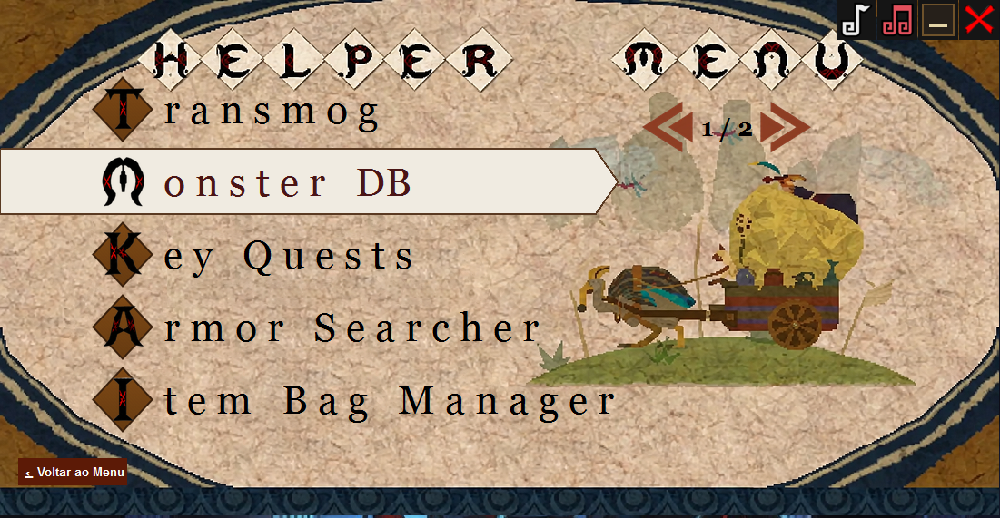 <b>Menu Principal</b></td>
    <td align="center">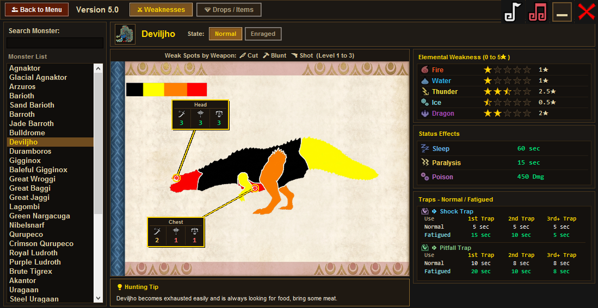 <b>Monster DB (Charts &amp; Fraquezas)</b></td>
    <td align="center">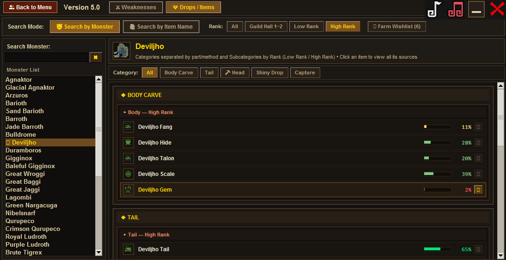 <b>Monster Drops (%)</b></td>
    <td align="center">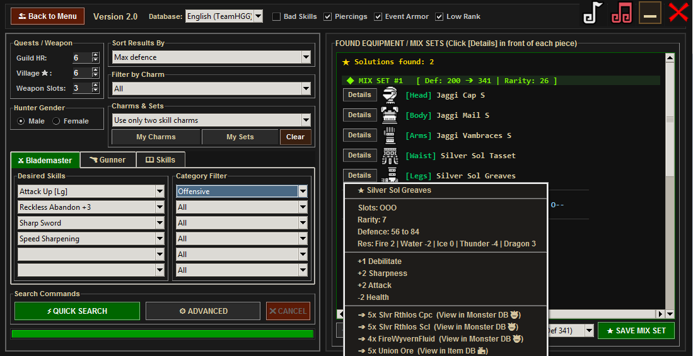 <b>Armor Searcher</b></td>
    <td align="center">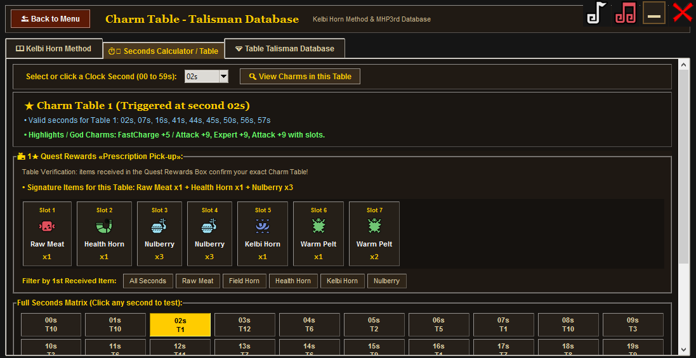 <b>Charm Table &amp; Método Kelbi Horn</b></td>
    <td align="center">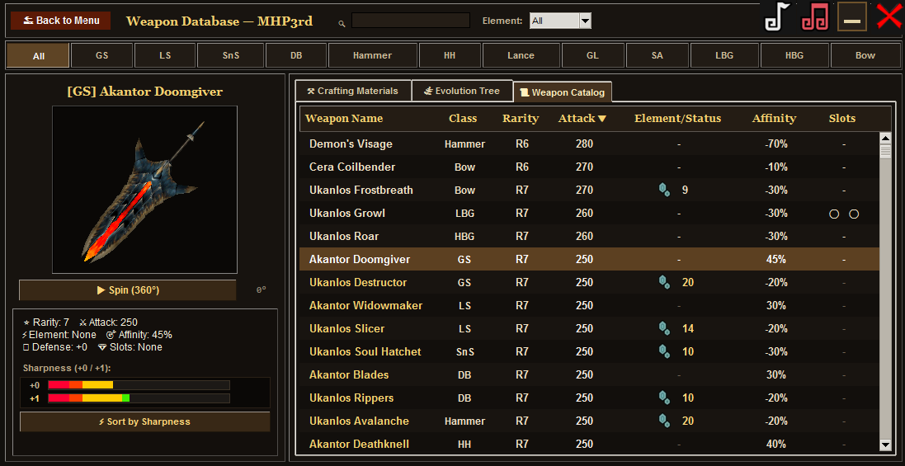 <b>Weapon DB</b></td>
    <td align="center">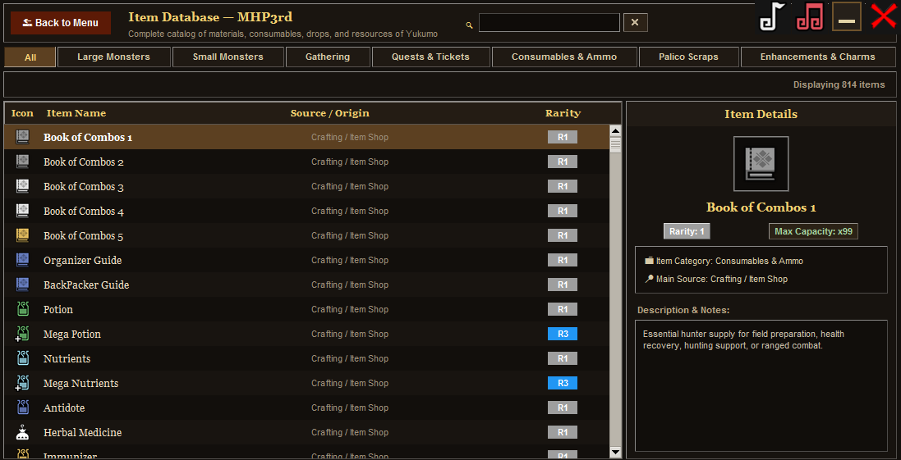 <b>Item DB</b></td>
    <td align="center">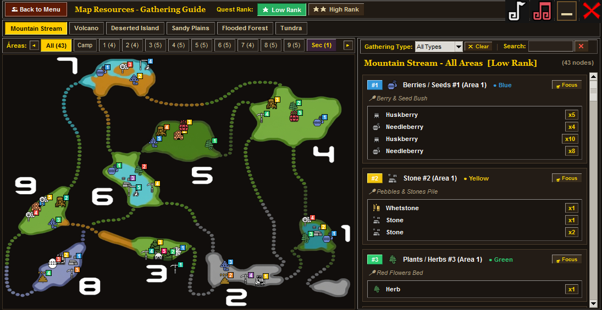 <b>Map Resources</b></td>
    <td align="center">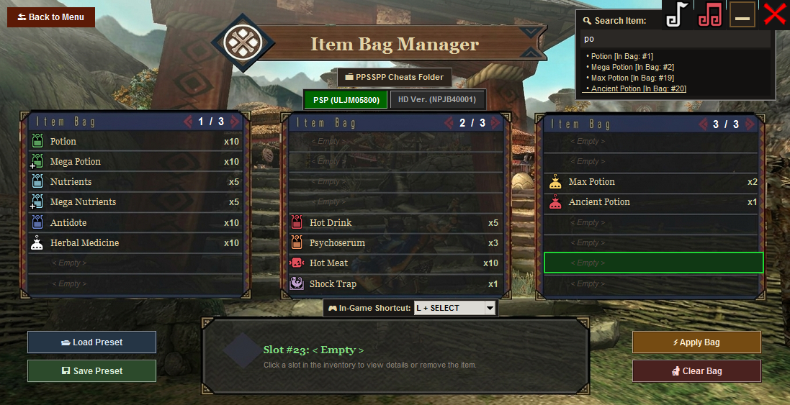 <b>Item Bag Manager</b></td>
    <td align="center">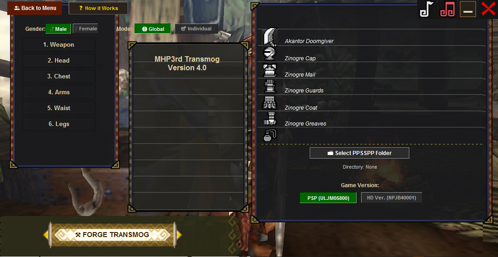 <b>Transmog</b></td>
    <td align="center">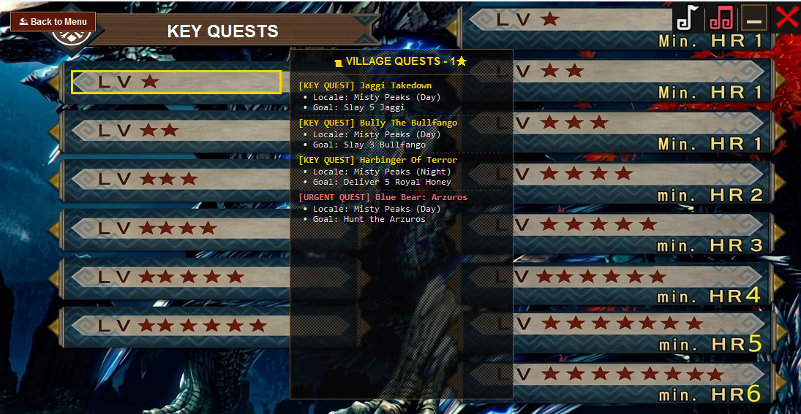 <b>Key Quests</b></td>
  </tr>
</table>

---

### Funcionalidades e Telas do App

#### 1. Tela Inicial e Menu Principal
- **Tela Inicial:** Seleção rápida de idioma (**PT / EN**), botão **Iniciar**, tela de **Créditos** e opção de **Doação**.
- **Menu Principal:** Central de navegação rápida com acesso direto a todas as ferramentas do app, além de botões globais para mutar/ativar música e efeitos sonoros, minimizar e fechar.

#### 2. Transmog (Armaduras Visuais)
- Permite mudar a aparência de qualquer uma das 5 peças equipadas (**Cabeça, Peito, Braços, Cintura e Pernas**) mantendo intactos os status e skills reais da sua armadura.
- Suporte a **Masculino / Feminino**, **Blademaster / Gunner** e busca rápida por nome.
- Aplica os códigos diretamente no arquivo de cheats do **PPSSPP** sem apagar outros cheats que você já tenha salvos.

#### 3. Monster DB — Monster Charts (Fraquezas e Áreas de Dano)
- **Imagem do Corpo e Hitzones:** Exibe o corpo do monstro com as áreas de dano de **Corte (Slash)**, **Impacto (Blunt)** e **Tiro (Shot)** para você saber exatamente onde bater.
- **Fraquezas Elementais e Status:** Mostra a eficácia de todos os elementos (*Fogo, Água, Trovão, Gelo e Dragão*) e status (*Veneno, Paralisia, Sono e KO*).
- **Eficácia de Itens e Armadilhas:** Indica se *Pitfall Trap, Shock Trap, Flash Bomb, Sonic Bomb e Carnes* funcionam no monstro, incluindo duração ou imunidade.
- **Estados do Monstro:** Monstros que mudam de forma ou quebram partes permitem alternar o estado para ver as fraquezas e a imagem atualizadas.
- **Dicas de Caçada** e alternância rápida para os drops do monstro selecionado.

#### 4. Monster Drops (Drops e Farm)
- Mostra todos os itens que cada monstro dropa, separados por **Rank** e **Método** (*Carve, Captura, Quebra de Parte, Shiny Drop, Recompensa*), com quantidade e **porcentagem exata (`%`)**.
- **Busca por Monstro ou por Item:** Pesquise um monstro específico ou pesquise pelo nome do material para descobrir todos os monstros que dropam aquele item.
- **Etiquetas de Farm:** Marque os itens que você está farmando para destacar na lista e filtrar apenas os monstros que dropam o que você precisa.

#### 5. Key Quests
- Guia rápido de progressão para **Vila** e **Guild Hall**, organizado por estrelas e ranks.
- Destaca todas as **Key Quests** obrigatórias e **Urgent Quests**, mostrando monstros-alvo, mapa e requisitos para avançar de rank.

#### 6. Armor Searcher
- Buscador completo de combinações de sets mistos de armadura (estilo **Athena's ASS**), totalmente integrado ao aplicativo.
- Filtre por **Rank**, **Gênero**, **Blademaster / Gunner**, **Slots da Arma**, **Defesa Mínima**, seus **Charms salvos (`mycharms.txt`)** e múltiplas **Skills desejadas**.
- Permite fixar ou excluir peças específicas, salvar seus sets favoritos em **Meus Sets** e visualizar todos os **materiais necessários** para forjar o set.

#### 7. Charm Table (Método Kelbi Horn e Descoberta de Tabela)
- **Guia do Método Kelbi Horn:** Explica passo a passo como funciona o método da quest *Kelbi Horn* para manipular o RNG do jogo e conseguir exatamente os charms que você procura.
- **Tabela Completa de Charms:** Lista os charms disponíveis em cada tabela para consulta rápida.
- **Descobridor de Tabela:** Ferramenta para identificar exatamente em **qual Charm Table** o seu personagem está no momento com base nos charms que você já possui ou obteve.

#### 8. Item Bag Manager (Gerenciador de Mochila)
- Monte e salve presets completos para os **24 slots da mochila** respeitando o limite de carregamento de cada item.
- Crie configurações prontas por tipo de caçada (ex.: *Gunner, Captura, Elder Dragon, Coleta*) e alterne entre elas rapidamente.
- Configure um atalho de botões e aplique o preset diretamente no **PPSSPP** com trava de segurança (só funciona com o Baú de Itens aberto dentro do jogo, exibindo som e notificação na tela).

#### 9. Weapon DB (Base de Dados de Armas)
- Enciclopédia com todas as **classes de armas** do jogo, com filtros por tipo, elemento/status, raridade e busca por nome.
- **Visualização 3D em 360°:** Render 3D interativo das armas para girar e ver cada modelo em **360 graus**.
- Exibe Ataque, Afinidade, Slots, **Afiação (normal e com Sharpness +1)**, **Phials das Switch Axes**, **Notas Musicais e Melodias com os buffs** (Hunting Horn), **Tipos de Munição/Revestimento** (Bowguns/Bow), **Árvore de Upgrades** (evoluções anteriores e seguintes) e **materiais de Criação e Melhoria**.

#### 10. Item DB (Base de Dados de Itens)
- Catálogo pesquisável com todos os itens do jogo, mostrando **raridade**, **limite máximo na mochila**, categoria, origem de obtenção, descrições e dicas de combinação.
- Filtros por categoria, monstro associado ou tipo de recurso de coleta.

#### 11. Map Resources (Recursos dos Mapas)
- Mapas interativos de coleta para todas as áreas do jogo por **Rank**.
- Pontos numerados diretamente sobre o minimapa (*Mineração, Insetos, Plantas, Cogumelos, Ossos, Pesca e Áreas Secretas*) exibindo cada item coletável e sua **porcentagem (`%`)**.
- **Busca por Item no Mapa:** Pesquise um recurso para destacar em quais mapas, áreas e pontos exatos ele aparece.

---

### Conexões Inteligentes Entre Telas

As telas trabalham conectadas entre si para agilizar a sua caçada sem precisar ficar voltando ao menu e digitando tudo de novo:

- **Armor Searcher ➔ Monster Drops / Item DB:**  
  Ao clicar em qualquer material da lista de criação de um set:
  - Se for um **item de Boss / Monstro**, o app abre direto o **Monster DB na aba de Drops** já filtrado naquele item, mostrando de qual monstro dropa, método e qual a **`%`**.
  - Se for um **item geral** (minério, inseto, osso, ticket, etc.), abre direto o **Item DB** com o item selecionado.
- **Armor Searcher ➔ Charm Table:**  
  Integrado ao buscador de armaduras para que você possa consultar diretamente na **Charm Table** em **qual tabela** consegue o charm usado no seu set.
- **Weapon DB ➔ Monster Drops / Item DB:**  
  Clicar em qualquer material na aba de criação ou upgrade de uma arma leva automaticamente para o **Monster Drops** (itens de monstro) ou para o **Item DB** (materiais gerais).
- **Monster DB (Charts) ⇄ Monster Drops:**  
  Alterne entre as **fraquezas/hitzones** e os **drops** mantendo o mesmo monstro selecionado, ou clique em qualquer item na lista de drops para ver todos os monstros que o dropam.
- **Item DB ➔ Map Resources:**  
  Para itens coletáveis nos mapas, basta clicar para ir direto ao **Map Resources** já mostrando em quais mapas, áreas e pontos aquele item pode ser coletado e com qual `%`.
- **Botão "Voltar" Inteligente:**  
  Sempre que você pula de uma tela para outra, o botão **Voltar** lembra de onde você veio e retorna direto para a tela anterior sem perder sua pesquisa.

---

### 🛠️ Sistema de "Mods" via Cheats (Sem Alterar a ISO)

Diferente de mods tradicionais que exigem extrair, editar ou substituir arquivos internos da ISO do jogo, as funções de modificação do **MHP3rd Helper** (*Transmog* e *Item Bag Manager*) funcionam através do sistema nativo de **Cheats do PPSSPP**:

- **Sua ISO continua 100% intacta:** Não altera nem corre risco de corromper os arquivos originais do jogo.
- **Zero complicação:** Você não precisa extrair nem recompilar ISO — é só aplicar pelo app e jogar.
- **Liga e desliga na hora:** Basta ativar ou desativar no menu de cheats do emulador quando quiser, sem precisar desfazer alterações permanentes.
- **Compatível com patches de tradução:** Funciona normalmente com ISOs traduzidas (Português, Inglês, etc.), tanto na versão **Normal (`ULJM05800`)** quanto na **HD (`NPJB40001`)**.
- **Preserva seus outros cheats:** O app escreve apenas a seção dele no arquivo de cheats do jogo, mantendo intactos quaisquer outros códigos que você já use.

---

### Como Usar

1. Baixe a versão mais recente na aba **[Releases](../../releases)** deste repositório.
2. Extraia o arquivo em qualquer pasta do seu PC.
3. Abra o **`MHP3rd_Helper.exe`**.
4. *(Opcional para Transmog e Item Bag Manager)* Selecione a pasta `PSP/Cheats` do seu **PPSSPP** dentro dessas telas e ative **"Enable Cheats"** nas configurações do emulador.

---

## 🇺🇸 English (EN)

### What is Monster Hunter Helper?

**Monster Hunter Helper** is an offline desktop companion project built for *Monster Hunter* players, combining complete databases, set planning, and emulator utilities wrapped in the classic look and audio of the series.

> 🎮 **One dedicated app per game:**  
> Each **Monster Hunter Helper** release is built specifically for a different *Monster Hunter* title, with its own tailored databases, maps, gear tables, and features.  
> This release is **MHP3rd Helper**, made specifically for **Monster Hunter Portable 3rd** (PSP / PPSSPP emulator), supporting both the **Normal Version (`ULJM05800`)** and the **HD Version (`NPJB40001`)**.

### Highlights

- **No installation needed:** Just download, extract, and run.
- **100% Offline:** All databases, images, maps, and audio work without an internet connection.
- **English & Portuguese:** Switch languages anytime straight from the Title Screen.
- **Saved User Data:** Your settings, saved armor sets, item bag presets, farm tags, and your charms (**`mycharms.txt`**) are saved automatically alongside the app.

---

### 📸 Screenshots

> *Scroll sideways (`← / →`) to browse all screenshots or click any image to view full size.*

<table>
  <tr>
    <td align="center"> <b>Main Menu</b></td>
    <td align="center"> <b>Monster DB (Charts &amp; Weaknesses)</b></td>
    <td align="center"> <b>Monster Drops (%)</b></td>
    <td align="center"> <b>Armor Searcher</b></td>
    <td align="center"> <b>Charm Table &amp; Kelbi Horn Method</b></td>
    <td align="center"> <b>Weapon DB</b></td>
    <td align="center"> <b>Item DB</b></td>
    <td align="center"> <b>Map Resources</b></td>
    <td align="center"> <b>Item Bag Manager</b></td>
    <td align="center"> <b>Transmog</b></td>
    <td align="center"> <b>Key Quests</b></td>
  </tr>
</table>

---

### App Screens & Features

#### 1. Title Screen & Main Menu
- **Title Screen:** Quick **EN / PT** language switch, **Start** button, **Credits**, and **Donate** popups.
- **Main Menu:** Central hub with direct access to all tools, plus global controls for Music, SFX, minimize, and close.

#### 2. Transmog (Visual Armor)
- Change the appearance of your 5 equipped armor pieces (**Head, Chest, Arms, Waist, and Legs**) while keeping your original armor stats and skills intact.
- Supports **Male / Female**, **Blademaster / Gunner**, and quick name search.
- Applies cheats directly to **PPSSPP** without erasing any other cheats you already have.

#### 3. Monster DB — Monster Charts (Weaknesses & Hitzones)
- **Monster Body & Damage Zones (Hitzones):** Shows full-body monster artwork with **Cut (Slash)**, **Impact (Blunt)**, and **Shot (Ammo)** hitzone values so you know exactly where to strike.
- **Elemental Weaknesses & Statuses:** Detailed ratings for **Fire, Water, Thunder, Ice, Dragon** and **Poison, Paralysis, Sleep, KO**.
- **Item & Trap Effectiveness:** Shows whether *Pitfall Traps, Shock Traps, Flash Bombs, Sonic Bombs, and Meat* work on the monster, including durations or immunities.
- **Monster States:** Monsters with alternate forms or breakable parts let you toggle states to see updated artwork and weaknesses.
- **Hunting Tips** and instant switching to the selected monster's drops.

#### 4. Monster Drops (Drop Tables & Farm Tracker)
- Complete drop tables organized by **Rank** and **Method** (*Carve, Capture, Part Break, Shiny Drop, Quest Reward*) with quantities and **exact `%` rates**.
- **Search by Monster or by Item:** Browse all drops for a monster or reverse-search any material to see every monster that drops it.
- **Farm Tags:** Mark materials you are farming to highlight them and filter only the monsters that drop what you need.

#### 5. Key Quests
- Progression guide for **Village** and **Guild Hall**, organized by star level and rank.
- Highlights all mandatory **Key Quests** and **Urgent Quests**, showing target monsters, map, and rank requirements.

#### 6. Armor Searcher
- Built-in mixed-set armor builder (inspired by **Athena's ASS**), fully integrated into the app.
- Filter by **Rank**, **Gender**, **Blademaster / Gunner**, **Weapon Slots**, **Minimum Defense**, your saved **Charms (`mycharms.txt`)**, and desired **Skills**.
- Pin or exclude specific armor pieces, save builds to **My Sets**, and inspect the **full crafting materials list**.

#### 7. Charm Table (Kelbi Horn Method & Table Finder)
- **Kelbi Horn Method Guide:** Explains step by step how to use the *Kelbi Horn* method to manipulate RNG and snipe the exact charms you want.
- **Full Charm Tables:** View all charms available on each table.
- **Table Finder:** Identify **which Charm Table** your character is currently on based on the charms you have.

#### 8. Item Bag Manager
- Create and save **24-slot item pouch presets** while respecting each item's maximum carry limit.
- Save loadouts for different hunts (e.g., *Gunner, Capture, Elder Dragon, Gathering*) and switch between them anytime.
- Set a button shortcut and apply presets directly in **PPSSPP** with a built-in safety check (only activates when your in-game Item Box is open, complete with native sound and notification).

#### 9. Weapon DB
- Complete encyclopedia covering all **weapon classes** in the game, with filters by class, element/status, rarity, and name.
- **360° 3D Weapon Viewer:** Interactive 3D render of weapons so you can rotate and inspect every model in **360 degrees**.
- Displays Attack, Affinity, Slots, **Sharpness bars (base and Sharpness +1)**, **Switch Axe Phials**, **Hunting Horn musical notes and Melodies with their exact buffs**, **Bow/Bowgun ammo & coatings**, **upgrade trees** (previous and next weapons), and **Craft / Upgrade materials**.

#### 10. Item DB
- Searchable item catalog showing **rarity**, **max carry limit**, category, obtain source, descriptions, and combo info.
- Filter by category, associated monster, or gathering resource type.

#### 11. Map Resources
- Interactive gathering maps for every location across all **Ranks**.
- Color-coded numbered spots placed directly on the minimap (*Mining, Bugs, Herbs, Mushrooms, Bones, Fishing, Secret Areas*) listing every item and its **exact `%` chance**.
- **Reverse Item Search:** Look up any resource to highlight every map, area, and spot where it can be gathered.

---

### Smart Cross-Screen Connections

Every screen is linked so you never waste time re-typing searches across menus:

- **Armor Searcher ➔ Monster Drops / Item DB:**  
  Click any material in a set's crafting list:
  - Clicking a **Boss / Monster material** jumps straight to **Monster DB → Drops** filtered on that item, showing which monsters drop it, the method, and the exact **`%`**.
  - Clicking a **general item** (ore, bug, bone, ticket, etc.) jumps straight to **Item DB** focused on that item.
- **Armor Searcher ➔ Charm Table:**  
  Connected directly to **Charm Table** so you can check **which table** gives the charm required for your armor set.
- **Weapon DB ➔ Monster Drops / Item DB:**  
  Clicking any craft or upgrade material routes straight to **Monster Drops** (monster parts) or **Item DB** (general items).
- **Monster DB (Charts) ⇄ Monster Drops:**  
  Switch between **weaknesses/hitzones** and **drops** while staying on the same monster, or click any drop entry to see every monster that drops it.
- **Item DB ➔ Map Resources:**  
  For gatherable items, jump directly from **Item DB** into **Map Resources** showing every map, area, and spot where that item spawns along with `%` rates.
- **Context-Aware "Back" Button:**  
  Whenever you jump between screens, the **Back** button remembers where you came from and returns you straight to the previous screen with your search intact.

---

### 🛠️ Cheat-Based "Mods" System (No ISO Editing Required)

Unlike traditional mods that require unpacking, editing, or patching internal game files inside your ISO, **MHP3rd Helper**'s customization features (*Transmog* and *Item Bag Manager*) work through **PPSSPP's native Cheat system**:

- **Your ISO stays 100% untouched:** No risk of corrupting or modifying your original game files.
- **Zero hassle:** No ISO extraction, hex editing, or rebuilding needed — just apply through the app and play.
- **Toggle on/off anytime:** Enable or disable effects instantly in PPSSPP's cheat menu with no permanent changes.
- **Translation-patch friendly:** Works seamlessly with patched/translated ISOs across both the **Normal (`ULJM05800`)** and **HD (`NPJB40001`)** versions.
- **Keeps your existing cheats:** The app only updates its own sections in the cheat file without wiping out any other cheats you already use.

---

### How to Use

1. Download the latest release from the **[Releases](../../releases)** tab.
2. Extract the folder anywhere on your PC.
3. Run **`MHP3rd_Helper.exe`**.
4. *(Optional for Transmog & Item Bag Manager)* Point to your **PPSSPP** `PSP/Cheats` folder inside those screens and turn on **"Enable Cheats"** in PPSSPP settings.
